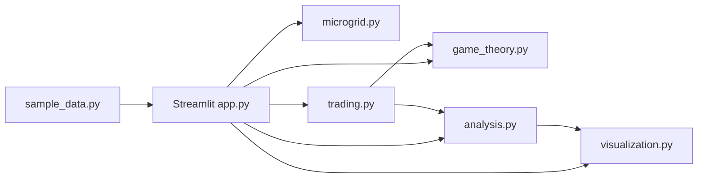

# Game-Theoretic Analysis of Renewable Energy Trading Among Microgrids

A local Python/Streamlit college project that simulates direct energy exchange among 3–6 microgrids, compares external-grid costs before and after trading, and separately computes pure-strategy Nash equilibria for a finite participation game. All built-in numbers are **simulated illustrative examples**, not real-world measurements.

## Abstract

Microgrids can have different solar generation and electricity demand during the same time step. A microgrid with excess renewable energy may be able to sell it to a neighboring microgrid that would otherwise purchase electricity from the external grid. This project implements a transparent marketplace, feasibility checks, individual/community cost accounting, interactive charts, CSV exports, and an exhaustive finite-game solver. It demonstrates how economic incentives and strategic participation can be studied computationally without paid APIs.

## 1. Introduction

Distributed renewable generation can create local energy surpluses and deficits. Peer-to-peer or community energy trading is one possible way to improve local use of renewable generation. Game theory provides a framework for representing participants as players whose payoffs depend on their own choices and other participants' choices.

## 2. Problem statement

Independent microgrids may leave some local renewable surplus unused while deficit microgrids purchase energy from the external grid. A simulation is needed to match feasible supply and demand, account for transaction prices, compare costs, and test whether a modeled strategic profile is stable against unilateral deviations.

## 3. Objectives

- Compute energy balance, surplus, and deficit for each microgrid.
- Match sellers and buyers subject to supply, demand, and price constraints.
- Calculate transaction values, seller revenues, buyer payments, residual grid purchases, and savings.
- Separate internal financial transfers from community-wide operating-cost savings.
- Enumerate a finite non-cooperative game, calculate payoffs and best responses, and verify pure Nash equilibria.
- Provide interactive visualization, CSV exports, automated tests, and viva preparation.

## 4. Existing system

A simple no-trading baseline assumes each deficit microgrid buys its full deficit from the external grid and surplus is not sold locally. This baseline is easy to calculate but does not represent local market coordination or strategic choices.

## 5. Proposed system

The proposed application adds deterministic greedy matching, a midpoint negotiated price, cost accounting, an exhaustive finite game solver, charts, and export files. The marketplace and game-theoretic solver are separate: the fact that a trade happens does not imply that the corresponding strategy profile is a Nash equilibrium.

## 6. System requirements

- Python 3.10 or newer recommended.
- Windows, macOS, or Linux.
- Internet connection only to install packages; the application itself requires no paid APIs or external service.
- Suggested minimum: 4 GB RAM. The default five-player game evaluates 3^5 = 243 strategy profiles; at six players it evaluates 3^6 = 729.

## 7. Technologies

- Python: core application and models.
- Streamlit: local interactive dashboard.
- NumPy/Pandas: data and numerical handling (Pandas is used directly; NumPy is available for extension).
- Plotly: interactive charts.
- NetworkX: graph layout for energy-trading network.
- Pytest: automated tests.
- CSV: portable result exports.
- SciPy is listed as an optional-ready numerical dependency but no SciPy optimizer is required by the current greedy matching algorithm.

## 8. System architecture



Responsibilities:
- `microgrid.py`: validated microgrid model and balance calculations.
- `sample_data.py`: five simulated default microgrids.
- `trading.py`: feasible midpoint pricing and energy matching.
- `analysis.py`: individual and community financial accounting.
- `game_theory.py`: finite strategy enumeration, payoff calculation, best response, and pure Nash equilibrium verification.
- `visualization.py`: Plotly charts and NetworkX graph layout.
- `app.py`: Streamlit dashboard and downloads.
- `tests/`: regression and correctness tests.

## 9. Mathematical model

For microgrid i, generation is G_i and demand is D_i:

`E_i = G_i - D_i`

`S_i = max(E_i, 0)`

`B_i = max(-E_i, 0)`

where S_i is surplus and B_i is deficit. For transaction quantity q_ij from seller i to buyer j:

`0 <= sum_j(q_ij) <= S_i`

`0 <= sum_i(q_ij) <= B_j`

`T_ij = q_ij * p_ij`

The price is the midpoint between the seller's minimum acceptable price p_min and the buyer's external-grid purchase price p_grid:

`p_ij = (p_min_i + p_grid_j) / 2`

A trade is feasible only when `p_min_i <= p_grid_j`. Therefore, the midpoint is not below the seller's reservation price or above the buyer's avoided grid price.

## 10. Game-theoretic formulation

**Players:** all configured microgrids.

**Strategies:** each player chooses `Abstain (0%)`, `Cautious (50%)`, or `Full (100%)`. The percentage controls how much of its own initial surplus (if a seller) or deficit (if a buyer) it offers to the marketplace. The marketplace is recalculated for every profile. Price is determined by the rule above rather than being a separate strategic variable.

**Payoff:** individual economic benefit relative to the no-trade baseline, calculated from reduced external purchases and internal sale revenue/purchase payments. A seller can benefit from revenue on surplus; a buyer benefits when the internal price is lower than the avoided grid cost. Individual payoff is not identical to community savings because internal payments are transfers.

**Best response:** for a given player and fixed strategies of all other players, evaluate each available strategy and return the strategy or tied strategies with maximum payoff.

**Pure Nash equilibrium:** a strategy profile is a pure Nash equilibrium if no player can increase their payoff by changing only their own strategy. The solver enumerates all 3^N profiles and tests every unilateral deviation. It reports all pure equilibria found or an empty equilibrium table when none exists; it does not fabricate results.

The test suite also checks two canonical games: a coordination game with known pure equilibria and matching pennies, which has no pure-strategy equilibrium.

## 11. Algorithms and workflow

1. Validate 3–6 microgrids and non-negative values.
2. Compute net energy, surplus, and deficit.
3. Sort sellers by minimum selling price and buyers by highest avoided grid price.
4. Greedily match feasible pairs until supply or demand is exhausted.
5. Calculate transaction value, residual deficit, external-grid costs, individual net costs, and community costs.
6. Enumerate strategy profiles for the finite game.
7. Recompute the market and payoffs for each profile.
8. Test all unilateral deviations to identify best responses and pure Nash equilibria.
9. Display charts/tables and provide CSV downloads.

## 12. Installation and execution

### Windows PowerShell

```powershell
cd path\to\microgrid_energy_trading
py -m venv .venv
.venv\Scripts\Activate.ps1
python -m pip install --upgrade pip
pip install -r requirements.txt
streamlit run app.py
```

If PowerShell blocks activation, either use Command Prompt with `.venv\Scripts\activate.bat`, or run the environment's Python directly: `.venv\Scripts\python.exe -m pip install -r requirements.txt` and `.venv\Scripts\python.exe -m streamlit run app.py`.

### macOS / Linux

```bash
cd microgrid_energy_trading
python3 -m venv .venv
source .venv/bin/activate
python -m pip install --upgrade pip
pip install -r requirements.txt
streamlit run app.py
```

Open the local address printed by Streamlit in your browser. To run the tests:

```bash
pytest -q
```

## 13. Results and discussion

The dashboard calculates results dynamically from the current inputs. The default five-microgrid sample contains sellers A, C, and E, and deficit microgrids B and D. Exact transaction quantities and costs are calculated by the application rather than hardcoded in this document. Exportable files include transaction details, individual results, community metrics, all strategy profiles, and pure Nash equilibria.

Community operating-cost savings are defined as the reduction in external-grid purchases valued at each buyer's grid price. Internal trade payments and seller revenues cancel across participants and are not added to community savings. Individual net savings include each participant's own payment or revenue.

## 14. Advantages

- Local execution without paid services.
- Transparent, reproducible pricing and matching rules.
- Dynamic inputs and charts.
- Explicit accounting constraints.
- Exhaustive equilibrium checking for a small finite strategy space.
- Downloadable CSV outputs and automated tests.

## 15. Limitations

- Single time-step model; no forecast, uncertainty, or multi-period dispatch.
- No electrical network losses, line limits, voltage constraints, taxes, or transaction fees.
- Battery capacity is an informational field only; charging/discharging and state of charge are not modeled.
- Greedy matching is deterministic but is not guaranteed to maximize global welfare for every possible market.
- Strategies scale offered quantity, while transaction prices are determined by the midpoint rule. This is a simplified finite participation game, not a full strategic bidding/price-setting market.
- Payoffs and equilibrium conclusions apply only to these assumptions and this strategy space.
- Renewable utilization is reported as `min(total generation, total demand) / total generation`; it is a coarse aggregate indicator and does not account for temporal mismatch or network losses.

## 16. Future scope

- Model battery state of charge, efficiencies, and charging/discharging limits.
- Add time-series solar/demand data and stochastic forecasts.
- Use linear programming or mixed-integer optimization for welfare-maximizing dispatch.
- Add strategic price offers and buyer bids, with richer payoff functions.
- Include line capacities, losses, and network constraints.
- Compare Nash equilibria with social optimum and investigate mixed-strategy equilibria.

## 17. Conclusion

This project provides an executable educational platform for renewable energy trading among microgrids. It separates physical energy matching, financial accounting, and game-theoretic equilibrium analysis, allowing the user to inspect how assumptions and strategies affect the calculated outcomes.

## 18. Academic references

The following are real, verifiable foundational sources. The project is an educational implementation and does not claim its simulated outputs are findings from these publications.

1. Nash, J. (1951). Non-Cooperative Games. *Annals of Mathematics*, 54(2), 286–295. https://doi.org/10.2307/1969529
2. Osborne, M. J. (2004). *An Introduction to Game Theory*. Oxford University Press. ISBN 978-0-19-512895-6.
3. Tushar, W., Saha, T. K., Yuen, C., Morstyn, T., Chapman, A. C., Alam, M. J. E., Hanif, S., & Poor, H. V. (2020). A review of peer-to-peer energy trading. *IEEE Transactions on Smart Grid*, 11(4), 3185–3200. https://doi.org/10.1109/TSG.2020.2969657
4. Zhang, C., Wu, J., Zhou, Y., Cheng, M., & Long, C. (2018). Peer-to-peer energy trading in a Microgrid. *Applied Energy*, 220, 1–12. https://doi.org/10.1016/j.apenergy.2018.02.077
5. National Renewable Energy Laboratory. *Microgrids*. https://www.nrel.gov/grid/microgrids.html
